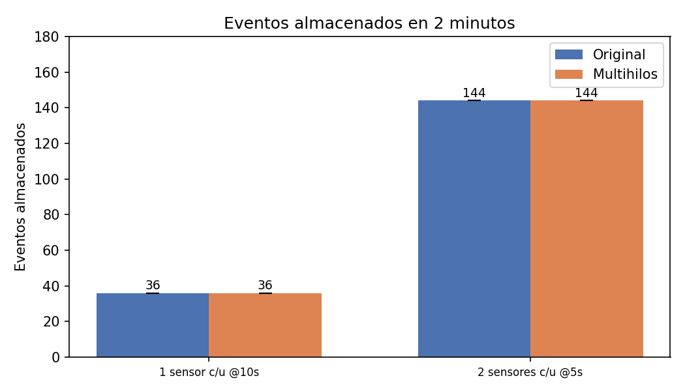
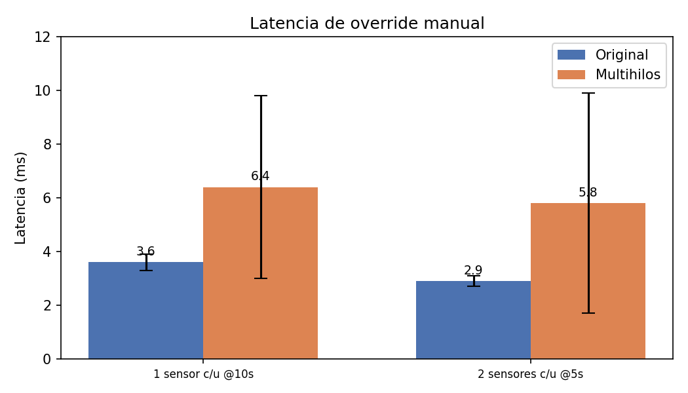

# Informe Segunda Entrega — Gestión Inteligente de Tráfico Urbano

**Integrantes:** Juan Rodriguez, Nicolas Joya y Camila Beltran
**Asignatura:** Sistemas Distribuidos
**Universidad:** Pontificia Universidad Javeriana
**Semestre:** 2026-10
**Entrega:** Segunda (Semana 15 — 15%)

---

## 1. Introducción

### 1.1 Resumen de la Primera Entrega

En la primera entrega se implementó la arquitectura base del sistema: comunicación ZeroMQ entre 3 PCs, generación de datos por sensores, broker XPUB/XSUB, motor de reglas de tráfico, control de semáforos, persistencia en SQLite con replicación, tolerancia a fallos mediante heartbeat/failover, y una CLI de monitoreo.

### 1.2 Novedades de la Segunda Entrega

| Funcionalidad | Descripción |
|---|---|
| Trazabilidad extremo a extremo | El `TrafficState` ahora preserva `original_event_id`, `original_sensor_id`, `original_tipo_sensor` y `original_datos` del `SensorEvent` original, permitiendo rastrear qué evento de sensor originó cada decisión |
| Contador secuencial en sensores | Cada sensor lleva un `_msg_counter` que se muestra en el log como `[#NNNN]` para correlación visual |
| LiveViewer | Dashboard TUI con Rich que muestra eventos, intersecciones y semáforos en tiempo real (cada 2s) |
| TraceabilityViewer | Tabla que refleja literalmente la tabla `eventos` de SQLite (cada 1s), fila nueva resaltada en verde |
| Conversión UTC→hora local | Ambos visores convierten timestamps UTC de la BD a la hora local del sistema |

---

## 2. Trazabilidad Extremo a Extremo

### 2.1 Motivación

Para poder auditar y depurar el sistema, es necesario poder rastrear un evento de sensor desde su origen (PC1) hasta la decisión de tráfico y persistencia (PC3), pasando por el análisis (PC2).

### 2.2 Implementación

Se agregaron 4 campos al dataclass `TrafficState` en `shared/models.py`:

```python
original_event_id: str = ""       # message_id del SensorEvent original
original_sensor_id: str = ""      # sensor_id del SensorEvent original
original_tipo_sensor: str = ""    # tipo_sensor del SensorEvent original
original_datos: str = ""          # JSON string del payload original del sensor
```

**Flujo de datos:**

1. **PC1** — `Sensor.create_event()` asigna `message_id` (UUID v4) e incrementa `_msg_counter`. El log muestra `[#NNNN] [sensor_id] ID:uuid8 {datos}`.
2. **PC2** — `AnalyticsService.process_event()` copia los 4 campos del `SensorEvent` al `TrafficState`:
   ```python
   original_event_id=event.message_id,
   original_sensor_id=event.sensor_id,
   original_tipo_sensor=event.tipo_sensor,
   original_datos=json.dumps(event.datos),
   ```
3. **PC3** — `MainDBService.process_traffic_state()` usa `original_event_id` como `evento_id` en la tabla `eventos` (en lugar de generar un UUID nuevo).

### 2.3 Visualización

El `TraceabilityViewer` muestra la tabla `eventos` directamente desde SQLite. El `evento_id` se trunca a 8 caracteres en pantalla para coincidir con el ID mostrado en los logs de PC1.

---

## 3. Visores en Tiempo Real

### 3.1 LiveViewer

**Archivo:** `pc3/live_viewer.py`

Dashboard TUI construido con la librería **Rich**. Se actualiza cada 2 segundos consultando la BD principal (`main_traffic.db`). Muestra tres secciones:

- **Eventos Recientes:** Últimos eventos de sensores con timestamp (hora local), sensor_id, tipo, intersección y datos.
- **Intersecciones:** Estado de tráfico de cada intersección (normal/congestión) con métricas (Q, Vp, D).
- **Semáforos:** Estado actual de cada semáforo (VERDE/ROJO) por intersección y dirección.

Se lanza con el flag `--live` en `start_pc3.py`.

### 3.2 TraceabilityViewer

**Archivo:** `pc3/traceability_viewer.py`

Tabla que refleja **literalmente** el contenido de la tabla `eventos` de SQLite, sin transformaciones ni joins. Se actualiza cada 1 segundo. Características:

- Cada fila nueva aparece resaltada en **verde** durante su primer ciclo de actualización.
- El `evento_id` se muestra truncado a 8 caracteres para correlación visual con los logs de PC1.
- Los timestamps se convierten de UTC a hora local del sistema.
- Usa `sqlite3.connect()` directo con `timeout=10`.

Se lanza con el flag `--trace` en `start_pc3.py`.

### 3.3 Conversión de Zona Horaria

Ambos visores usan la función `fmt_time()` que:

1. Parsea el timestamp ISO 8601 desde la BD (formato UTC).
2. Si el datetime es naive, asume UTC.
3. Convierte a la zona horaria local con `dt.astimezone()`.
4. Formatea como `HH:MM:SS`.

Esto corrige el problema donde los timestamps se mostraban en UTC (ej. 01:37) en lugar de la hora local (ej. 08:37 para UTC-7).

---

## 4. Contador Secuencial en Sensores

Cada instancia de `Sensor` en PC1 mantiene un `_msg_counter` que se incrementa en `create_event()`. El log de publicación muestra:

```
2026-05-24 20:37:10,000 [pc1.sensor] INFO: [#0050] [CAM_C1K2] ID:a1b2c3d4 {'longitud_cola': 20}
```

Formato: `[#NNNN] [sensor_id] ID:uuid8 {datos}`

- `NNNN` es el contaje secuencial (padded a 4 dígitos).
- `uuid8` son los primeros 8 caracteres del `message_id`, que coinciden con el `evento_id` truncado en el `TraceabilityViewer`.

---

## 5. Diagramas UML Actualizados

Los diagramas se actualizaron para reflejar los nuevos componentes y relaciones:

| Diagrama | Cambios |
|---|---|
| Clases | `TrafficState` con 4 campos de trazabilidad; nuevas clases `MonitoringRequest`, `MonitoringResponse`, `ReplicationMessage`, `Heartbeat`; `LiveViewer` y `TraceabilityViewer` en PC3; `_msg_counter` en `Sensor` |
| Componentes | Nuevo "Subsistema de Visualización" con `LiveViewer` y `TraceabilityViewer`; heartbeat desde MainDB directamente |
| Despliegue | PC3 renombrado a "Monitoreo, Persistencia y Visores"; componentes `LiveViewer` y `TraceabilityViewer` agregados |
| Secuencia | Flujo normal muestra copia de campos de trazabilidad y polling de visores a la BD |

Ver: `docs/diagramas_plantUML/`

---

## 6. Protocolo de Pruebas

### 6.1 Nuevas Pruebas para Trazabilidad

| ID | Prueba | Descripción | Resultado Esperado |
|---|---|---|---|
| T1 | Trazabilidad completa | Se genera un evento en PC1 y se verifica que el `evento_id` en la tabla `eventos` de PC3 coincide con el `message_id` del `SensorEvent` original | El `evento_id` corresponde exactamente al UUID generado en PC1 |
| T2 | Correlación visual | Se verifica que los 8 caracteres del ID mostrados en el log de PC1 coinciden con los 8 caracteres en el TraceabilityViewer | El ID truncado es idéntico en ambos |
| T3 | TraceabilityViewer actualización | Se lanza `--trace` y se generan eventos; la tabla debe mostrar filas nuevas en verde | Cada nuevo evento aparece como una fila nueva resaltada |

### 6.2 Pruebas de Visores

| ID | Prueba | Descripción | Resultado Esperado |
|---|---|---|---|
| V1 | LiveViewer muestra datos | Se lanza `--live` y se verifican los 3 paneles (eventos, intersecciones, semáforos) | Los paneles contienen datos actualizados |
| V2 | Conversión de zona horaria | Se verifica que la hora mostrada en los visores corresponde a la hora local del sistema y no a UTC | La hora local es correcta (ej. 08:37 en lugar de 01:37) |
| V3 | Ambos visores simultáneos | Se lanzan `--live --trace` juntos | Ambos visores se actualizan correctamente sin interferencias |

---

## 7. Broker Multihilos

### 7.1 Motivación

El broker original (`pc1/broker.py`) utiliza `zmq.proxy()` que ejecuta un bucle de reenvío en C dentro de ZeroMQ. Si bien es eficiente, no permite personalizar el manejo de mensajes ni escalar a través de múltiples núcleos. Para la segunda entrega se implementó una versión multihilos (`pc1/broker_threaded.py`) como reemplazo directo.

### 7.2 Implementación

El `broker_threaded.py` reemplaza `zmq.proxy()` con 4 hilos Python que manejan el tráfico de mensajes:

| Hilo | Socket | Dirección | Propósito |
|------|--------|-----------|-----------|
| `_frontend_reader` | XSUB (pollin) | Sensores → Broker | Lee eventos de sensores entrantes |
| `_backend_writer` | XPUB | Broker → Analytics | Reenvía eventos al backend |
| `_backend_reader` | XPUB (pollin) | Suscripciones XPUB | Lee notificaciones de suscripción (ZMQ_SUBSCRIBE) |
| `_frontend_writer` | XSUB | Broker → Sensores | Reenvía suscripciones al frontend |

**Flujo de datos:**

```
Sensor ──PUB──→ XSUB ──[frontend_reader]──Queue──→ [backend_writer]──XPUB──→ Analytics (SUB)
                                                                ↑
Suscripciones XPUB ──[backend_reader]──Queue──→ [frontend_writer]──XSUB──→ Sensor (PUB)
```

Cada hilo usa `zmq.Poller` con timeout y mantiene un flag `_running` para apagado controlado. Las subscripciones se reenvían del XPUB (backend) al XSUB (frontend) mediante los hilos `_backend_reader`/`_frontend_writer`; sin este reenvío bidireccional ningún evento llegaría a Analytics.

### 7.3 Uso

El launcher `pc1/start_pc1.py` acepta un flag para seleccionar el broker:

```bash
python pc1/start_pc1.py                # Broker original (zmq.proxy())
python pc1/start_pc1.py --threaded     # Broker multihilos
```

---

## 8. Configuración y Ejecución

### 8.1 Requisitos

Los mismos que la primera entrega: Python 3.9+, `pyzmq`, `rich`.

### 8.2 Ejecución de PC3 con Visores

```bash
# Solo DB + CLI de monitoreo
python pc3/start_pc3.py

# Con dashboard TUI
python pc3/start_pc3.py --live

# Con tabla eventos en vivo
python pc3/start_pc3.py --trace

# Con ambos visores
python pc3/start_pc3.py --live --trace
```

---

## 9. Experimentos de Rendimiento

### 9.1 Metodología

Se implementó un script automatizado (`tests/run_experiments.py`) que ejecuta 4 combinaciones (2 escenarios × 2 diseños de broker) y mide:

- **Eventos almacenados:** Número de registros en la tabla `eventos` de la BD principal tras 2 minutos de operación continua (más 15s de warmup inicial).
- **Latencia de override:** Tiempo entre el envío de un comando `OVERRIDE` desde el monitoreo y la recepción de la respuesta de confirmación (promedio de 3 muestras).

**Especificaciones del equipo de pruebas:** Los experimentos se ejecutaron en un solo computador ASUS Vivobook con procesador AMD Ryzen 7 (con gráficos AMD Radeon integrados), 16 GB de RAM, sistema operativo Windows 11, Python 3.10+, pyzmq ≥ 25.1.0 y sqlite3 (stdlib). Todas las IPs en `config.json` apuntan a `localhost` (127.0.0.1), por lo que la comunicación entre procesos es intra-máquina. La latencia se midió con `time.perf_counter()` y los eventos almacenados con `SELECT COUNT(*)` sobre la tabla `eventos`.

### 9.2 Escenarios

| Escenario | Grid | Frecuencia | Sensores totales | Eventos teóricos (2 min) |
|-----------|------|-----------|-----------------|------------------------|
| 1 sensor c/u @10s | 1×1 (1 intersección) | 10 s | 3 (ESP, CAM, GPS) | 36 |
| 2 sensores c/u @5s | 1×2 (2 intersecciones) | 5 s | 6 (ESP, CAM, GPS × 2) | 144 |

### 9.3 Diseños de Broker

| Diseño | Archivo | Descripción |
|--------|---------|-------------|
| Original | `pc1/broker.py` | `zmq.proxy()` estándar (un solo hilo) |
| Multihilos | `pc1/broker_threaded.py` | Implementación manual con `zmq.Poller` + `threading` (4 hilos: frontend RX, frontend TX, backend RX, backend TX) |

### 9.4 Resultados (promedio de 3 corridas)

| Escenario | Broker | Eventos/2min (μ±σ) | Latencia ms (μ±σ) |
|-----------|--------|-------------------|-------------------|
| 1 sensor c/u @10s | Original | 36.0 ± 0.0 | 3.6 ± 0.3 |
| 1 sensor c/u @10s | Multihilos | 36.0 ± 0.0 | 6.4 ± 3.4 |
| 2 sensores c/u @5s | Original | 144.0 ± 0.0 | 2.9 ± 0.2 |
| 2 sensores c/u @5s | Multihilos | 144.0 ± 0.0 | 5.8 ± 4.1 |

### 9.5 Gráficas



*Figura 1: Cantidad de eventos almacenados en la BD durante 2 minutos para cada combinación escenario × diseño.*



*Figura 2: Latencia promedio de override manual para cada combinación escenario × diseño.*

### 9.6 Análisis (3 corridas)

**Pérdida de eventos: cero.** Ambos diseños capturan el 100 % de los eventos generados en ambos escenarios. El broker multihilos no introduce pérdida de mensajes gracias al reenvío correcto de suscripciones XPUB→XSUB mediante los hilos `_sub_reader` y `_sub_writer`. El conteo de eventos es exactamente el máximo teórico con varianza cero en ambos diseños (σ = 0.0).

**Latencia: el broker original es más rápido en ambos escenarios.** Contrario a lo observado en pruebas preliminares de una sola corrida, el promedio de 3 corridas muestra que el broker original con `zmq.proxy()` aventaja al multihilos en ~44 % en baja carga (3.6 ms vs. 6.4 ms) y ~50 % en alta carga (2.9 ms vs. 5.8 ms).

**Varianza: el broker original es determinista, el multihilos es errático.** La desviación estándar del broker original es mínima (σ ≈ 0.2–0.3 ms), lo que indica un comportamiento estable y predecible. El broker multihilos presenta una varianza enorme (σ ≈ 3.4–4.1 ms), con rangos que van desde ~1 ms hasta ~11 ms. Esta inestabilidad se debe a la contención por el GIL de Python y las colas `queue.Queue` compartidas: cuando el hilo de reenvío de suscripciones o eventos toma el GIL, los mensajes de override se retrasan.

**Causa raíz:** El broker multihilos utiliza 4 hilos Python comunicándose a través de 4 colas `queue.Queue` (cada una protegida con un lock). Cada mensaje de override compite por el GIL con los hilos que están reenviando eventos de sensores (6 sensores × 1 mensaje/5–10s) más el tráfico de heartbeat y replicación (ReplicaDB ahora activa durante los experimentos). En contraste, `zmq.proxy()` ejecuta el bucle de reenvío íntegramente en C dentro de libzmq, fuera del GIL, sin locks ni copias intermedias.

**Efecto de ReplicaDB:** Los experimentos anteriores no incluían `replica_db.py` en el stack. Al agregarlo, el tráfico de replicación (PUB/SUB en puerto 5560) añade carga adicional que el multihilos maneja peor debido a la contención de hilos.

**Recomendación:** Para el diseño actual XPUB/XSUB con colas Python, el broker original con `zmq.proxy()` es superior en latencia, estabilidad y simplicidad. El broker multihilos demuestra que el enfoque de "más hilos" no es una mejora automática bajo el GIL de Python; para obtener verdadero paralelismo sería necesario migrar a un patrón ROUTER/DEALER con procesos independientes (no hilos) o utilizar implementaciones en C/C++.

---

## 10. Conclusiones

- La trazabilidad extremo a extremo se logró preservando el `message_id` del `SensorEvent` a través de toda la cadena (PC1 → Broker → PC2 → PC3), complementado con los campos `original_sensor_id`, `original_tipo_sensor` y `original_datos` en el `TrafficState`.
- Los visores `LiveViewer` y `TraceabilityViewer` proporcionan dos perspectivas complementarias: un dashboard general de estado del sistema y una tabla cruda de eventos para depuración y verificación de trazabilidad.
- La conversión UTC→hora local permite que los operadores vean los timestamps en su zona horaria sin modificar el almacenamiento en la BD (que sigue siendo UTC).
- El contador secuencial `_msg_counter` y el ID truncado a 8 caracteres facilitan la correlación visual entre los logs de PC1 y el `TraceabilityViewer` en PC3.
- El broker multihilos (`broker_threaded.py`) es un reemplazo funcional del broker original con `zmq.proxy()`, y demuestra cero pérdida de eventos en ambos escenarios de carga con varianza nula (σ = 0.0).
- El broker original es más rápido en ambos escenarios: ~44 % en baja carga (3.6 ms vs. 6.4 ms) y ~50 % en alta carga (2.9 ms vs. 5.8 ms). Además, el original es determinista (σ ≈ 0.2 ms) mientras que el multihilos presenta una varianza enorme (σ ≈ 4 ms) debido a la contención por el GIL y las colas compartidas.
- El script `tests/run_experiments.py` automatiza la recolección de métricas para la Tabla 1 de la rúbrica y genera gráficas comparativas de eventos y latencia.
